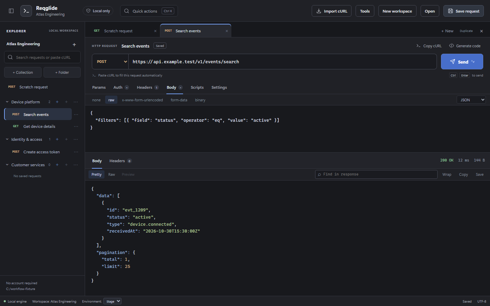

# Reqglide

[Website](https://sid532001.github.io/reqglide/) ·
[Getting started](https://sid532001.github.io/reqglide/docs/) ·
[Contributing](CONTRIBUTING.md) · [Roadmap](docs/roadmap.md)



Reqglide is a production-oriented, local-first API development workspace. It is
being built around a reusable Rust execution engine, a Tauri desktop shell, and
a React interface. An account or cloud workspace is not required.

## Current milestone

The application now has a production-oriented local V1 foundation:

- protocol-independent request and response models;
- a reusable asynchronous HTTP executor;
- a headless CLI that uses the same executor as the desktop application;
- a Tauri command boundary;
- a request builder and response inspector;
- request/response size limits, request timeouts, headers, structured query
  parameters, raw bodies, URL-encoded forms, multipart form data, and streamed
  binary/file bodies;
- local workspace creation and opening through native folder dialogs;
- a versioned, Git-friendly `workspace.yaml` format;
- collections, nested folders, saved requests, and workspace search;
- validated, size-bounded loading and atomic workspace writes;
- cURL import from the dialog or by pasting into the URL or workspace-search
  field, including `--data-urlencode`, multipart/file/upload flags, and cleanup
  of Markdown-formatted commands;
- environment-resolved cURL export for PowerShell and POSIX shells, including
  auth, query parameters, forms, multipart parts, and local file references;
- persisted environments with `{{variable}}` interpolation;
- OS-keychain-backed secret environment values that never enter shareable YAML,
  visible machine-local values that also stay out of YAML, native interpolation,
  and script/error redaction;
- Basic, bearer-token, API-key, and OAuth 2.0 client-credentials
  authentication, optional OIDC discovery, and workspace/collection/folder auth
  inheritance;
- isolated workspace cookie jars plus system/custom/disabled proxy modes,
  no-proxy rules, custom CA bundles, PEM client identities for mTLS, and an
  explicit insecure-certificate warning;
- per-request pre-request and post-response scripts executed in a native,
  resource-limited QuickJS sandbox, with an initial Postman-style `pm` API,
  console output, and test results;
- Pretty/Raw response views, safe offline HTML preview, response search/wrap,
  copy, and native body save;
- multiple request tabs, debounced native crash-recovery snapshots, and local
  SQLite request history with search, pin, restore, delete, and clear controls;
- collection and folder runs with environment selection, iterations, delays,
  stop-on-failure, CSV/JSON data rows, persistent reports, and JSON/JUnit export;
- Postman collection/environment and OpenAPI/Swagger JSON/YAML import with
  explicit migration warnings;
- persisted GraphQL, WebSocket, Server-Sent Events, and dynamic gRPC profiles,
  including GraphQL introspection, WebSocket text/binary/ping, SSE event
  streaming, and reflection or descriptor-set based gRPC calls across all four
  RPC cardinalities;
- rename, deep duplicate, delete, cycle-safe folder/request moves, and sibling
  reordering in the workspace tree;
- unsigned Windows NSIS and MSI packaging.

This is a serious V1 baseline, not a claim of complete Postman parity. See
[`docs/roadmap.md`](docs/roadmap.md) for the delivery sequence and
[`docs/feature-matrix.md`](docs/feature-matrix.md) for the explicit Postman
parity summary. The exhaustive acceptance ledger is
[`docs/capability-coverage.md`](docs/capability-coverage.md).

Public release blockers, the Windows candidate build, signing requirements,
and the current hardening threat model are tracked in
[`docs/production-readiness.md`](docs/production-readiness.md).

## Repository layout

```text
apps/
  cli/                 Headless client and future CI runner
  desktop/             React UI and Tauri adapter
  site/                Product landing page and getting-started guide
crates/
  core/                Stable domain models shared by every adapter
  history/             Bounded local SQLite request history
  http/                HTTP transport and response capture
  import/              cURL, Postman, OpenAPI, and Swagger adapters
  protocol/            GraphQL-adjacent realtime transports and dynamic gRPC
  script/              Resource-limited QuickJS request scripting
  vault/               OS credential-store secret references and transactions
  workspace/           Versioned schema, validation, and atomic persistence
docs/decisions/        Architecture decision records
```

## Prerequisites

- Node.js 24 or newer
- pnpm 11 (the repository pins 11.19.0)
- Current stable Rust toolchain
- Platform prerequisites required by Tauri 2

## Development

For the product landing page, run `pnpm site:dev` and open
`http://127.0.0.1:4173`. Build static files with `pnpm site:build`; the output at
`apps/site/dist/index.html` also opens directly in a browser. The desktop app
uses a separate entry point and requires the development command below.

```shell
pnpm install
cargo test --workspace
pnpm check
pnpm test
pnpm dev
```

For browser workflow checks, install Chromium once, then run:

```shell
pnpm --filter @local-api/desktop exec playwright install chromium --only-shell
pnpm test:e2e
```

These checks run the React interface against simulated desktop IPC. Native
transport and script integration tests use local servers. See
[`docs/quality.md`](docs/quality.md) for verification scope and release gaps.

## Using the desktop application

1. Run `pnpm dev`.
2. Select **New workspace**, enter a name, and choose a parent folder. The app
   creates a portable child directory containing `workspace.yaml`.
3. Compose a request and select **Save request** to place it in a collection or
   nested folder.
4. Use **Open** later and select the workspace directory itself.

The **Tools** menu opens environments, history, the collection runner, protocol
workbench, cookies, network/TLS settings, and workspace authentication. Tabs and
unsaved editor state are recovered from a machine-local snapshot after an
unexpected exit.

Use **Import cURL** or paste a cURL command directly into the URL or workspace
search field. The importer also repairs common formatting added when commands
are copied from Markdown, such as `[URL](URL)`, `\--header`, and `grant\_type`.
The URL bar accepts multiline POSIX/PowerShell commands, copied shell prompts,
and fenced code blocks. Import populates the method, URL, query, headers,
authentication and body without sending a request. An edited or saved request
is preserved in its own tab. Use **Quick actions** or **Ctrl+K** to find commands.
Use **Environments** to create values such as `baseUrl`, choose **Shared**,
**Local**, or **Secret** storage, select the active environment in the status
bar, and reference values as `{{baseUrl}}` in a URL, query parameter,
authentication field, header, body, script, or protocol profile. Local and
secret values are stored in Windows Credential Manager, macOS Keychain, or the
Linux desktop secret service; only their metadata is written to
`workspace.yaml`. Secret values are not revealed back to the editor.

The **Headers** tab separates saved headers from the headers the native HTTP
runtime will generate, such as `Host`, `Content-Length`, and the cookie-jar
header. Variable references are annotated with their active-environment status;
secret variables show only that a keychain value is stored, never its value.
For example, store `basic_auth_stage` as a **Secret**, activate that
environment, and use `{{basic_auth_stage}}` as the `Authorization` header.
The response viewer's **Extract variable** action preserves an existing
variable's storage type and defaults new token variables to Secret storage.
Post-response scripts can also update existing Secret variables natively; see
[`docs/scripting.md`](docs/scripting.md).

Use the **Body** tab for raw, URL-encoded, multipart form-data, or binary
payloads. Multipart and binary files are selected with the native picker and
streamed only after **Send** is selected. Workspaces store the local path, not
the file bytes, so paths may need updating when a workspace moves to another
machine. The default aggregate upload limit is 100 MiB.

Script source is saved with each request and runs only when **Send** is selected.
Every phase uses a fresh native QuickJS runtime with a two-second deadline,
64 MiB heap limit, stack/source/context limits, and no filesystem, network,
module loader, process, or desktop-bridge capability. The initial `pm` API and
known compatibility gaps are documented in
[`docs/scripting.md`](docs/scripting.md); scripts are never evaluated inside the
privileged webview.

The default example URL is populated in the editor, but no request is sent
until the user explicitly selects **Send**. Workspace files are human-readable
and can be committed to Git. The format and its compatibility guarantees are
documented in [`docs/workspace-format.md`](docs/workspace-format.md).

## Backup and support

Use **Tools → Back up workspace** for a private copy of saved configuration,
**Restore workspace backup** to create a separate workspace, and **Export support
diagnostics** for app/configuration information that excludes request data and
credentials. Backups are unencrypted and include Shared values and literal
credentials; Secret/Local values remain device-only. See the
[backup and support guide](docs/backup-and-support.md) before exporting.

## Windows installers

Build internal preview installers with:

```powershell
./scripts/build-windows.ps1 -Preview
```

NSIS and MSI packages named `reqglide_0.1.1_windows-x64-setup.exe` and
`reqglide_0.1.1_windows-x64.msi`, a build manifest, and SHA-256 checksums are written
to `.release-artifacts/windows/0.1.1/`. A signing certificate has not been obtained;
these installers are internal previews. The script also supports a verified
signed-candidate path once a publisher identity is available. See
[Windows release readiness](docs/production-readiness.md) for signing setup and
the remaining public-release gates, and the
[dependency review](docs/dependency-audit.md) for current advisory findings.

## Corporate network troubleshooting

A request that succeeds in Postman but times out here may use a different proxy
route. Match the settings in **Tools → Network & TLS**. **Custom proxy** takes
an HTTP/SOCKS proxy URL and optional credential references. Do not copy a
Postman-specific proxy into the Windows-wide configuration.

On Windows, HTTP execution in **Use system proxy** mode also resolves PAC/WPAD
with the native WinHTTP API. Explicit environment proxy variables take
precedence; custom and disabled modes are respected. Proxy discovery runs off
the async runtime and is time-bounded. PAC decisions use the destination origin
only; use Custom proxy for path-specific rules or authenticated PAC downloads.
Streaming protocol clients can use the explicit Custom proxy configuration.

Connection setup, response-header waits, and response-body timeouts have
separate errors. The response error view links to proxy and timeout settings.
For bearer authentication, enter the raw token or `{{access_token}}` in
**Auth → Bearer Token**; the `Bearer` prefix is added automatically. A manual
`Authorization` header requires the full `Bearer {{access_token}}` value.

## Privacy baseline

- Request data is processed locally.
- Telemetry is not enabled.
- Saved URLs, headers, authentication settings, bodies, and **Shared**
  environment values are plain text in `workspace.yaml`. Store credentials as
  **Secret** and device-specific non-secret configuration as **Local**.
- Cloud features will be optional adapters if they are introduced later.

## Community and license

Reqglide is [MIT licensed](LICENSE). Start with the [contributor guide](CONTRIBUTING.md),
report a [bug](https://github.com/Sid532001/reqglide/issues/new?template=bug_report.yml),
or propose a [feature](https://github.com/Sid532001/reqglide/issues/new?template=feature_request.yml).
The current Windows downloads are unsigned previews for evaluation. Production
release acceptance remains tracked in the release-readiness checklist.
